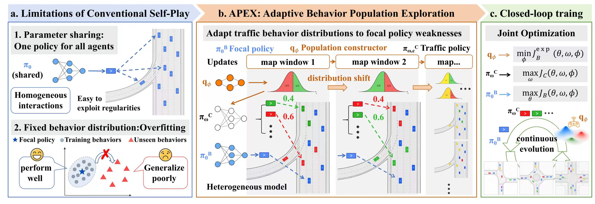

# APEX: Robust Driving Self-Play through Adaptive Population Exploration

**APEX** learns a robust focal driving policy by adapting the behavior distribution
of a separately trained traffic population. This repository builds on
[BehaviorBench](https://github.com/boschresearch/behavior-bench) and
[PufferDrive](https://github.com/Emerge-Lab/PufferDrive).

[](docs/assets/introduction.jpg)

*Overview of APEX. A focal policy and a behavior-conditioned traffic policy learn
through interaction, while a population constructor adapts which self-interested
traffic behaviors are encountered. Click the figure to view the full-size image.*

## Method

APEX addresses homogeneous self-play interactions and fixed training-time behavior
mixtures through:

- **Separate focal and traffic policies**, trained with policy-specific PPO updates
  and a nominal 50:50 agent allocation.
- **Behavior-conditioned traffic**, with four reward coordinates and two perception
  conditions controlling radius and field of view.
- **Adaptive population exploration**, using a learnable Gaussian descriptor to
  parameterize six Beta-distributed conditions, with critic-centered feedback.

The focal policy is evaluated independently: the population constructor and
traffic-condition selection are not needed to deploy it.

## Results

Results below are reported in **Table 1 of the APEX manuscript**, using the
[BehaviorBench](https://github.com/boschresearch/behavior-bench) evaluation protocol.
Each entry is the mean aggregate score over the complete **1,000-scene** split,
multiplied by 100; **higher is better**. Each planner uses one fixed checkpoint
across all eight traffic populations, with traffic-controller checkpoints shared
across planners. Bold indicates the best score in each column.

### Interactive1k

| Planner | IDM | PPO | SMART | Expert | Aggr. | Normal | Caut. | Mix |
|---|---:|---:|---:|---:|---:|---:|---:|---:|
| IDM | 15.05 | 16.91 | 15.70 | 12.13 | 19.21 | 16.29 | 12.53 | 15.39 |
| PDM | 23.99 | 23.01 | 30.43 | 20.60 | 33.66 | 28.66 | 19.36 | 27.03 |
| SMART | 22.53 | 29.11 | 30.94 | 28.04 | 32.86 | 30.16 | 22.28 | 27.83 |
| PPO | 38.73 | 51.54 | 41.69 | 29.40 | 49.17 | 43.32 | 39.15 | 43.44 |
| **APEX (Ours)** | **41.45** | **52.34** | **45.22** | **32.33** | **51.53** | **47.04** | **41.85** | **46.33** |

APEX achieves the highest score under all eight traffic populations on this
interaction-heavy split. The mean across populations increases from **42.06** for
PPO to **44.76** for APEX.

Aggr., Caut., and Mix denote aggressive, cautious, and mixed conditioned traffic.
See [EVALUATION.md](EVALUATION.md) for the evaluation commands and traffic settings.

## Installation

Use two isolated environments to separate the modern PyTorch simulator/trainer
from the legacy TensorFlow/Waymo preprocessing stack:

| Environment | Main dependencies | Purpose |
|---|---|---|
| `apex-train` | Python 3.11, PyTorch 2.5.1 / CUDA 11.8, PyG 2.7 | Training, binary conversion, evaluation |
| `apex-data` | Python 3.10, TensorFlow 2.11, Waymo SDK 1.6.1 | Raw WOMD preprocessing |

```bash
git clone https://github.com/sicheng09/mixed-intelligence.git
cd mixed-intelligence
bash scripts/setup_apex.sh
source scripts/apex_env.sh train
```

The installer builds the Drive C extension and the C/CUDA advantage kernel.
The training build requires a C/C++ compiler and the CUDA 11.8 toolkit. PyTorch
automatically selects CUDA architectures from the GPUs visible during the build.
When building without a visible GPU or for different target GPUs, set
`TORCH_CUDA_ARCH_LIST` explicitly. Environments, caches, data, and run outputs stay
under `APEX_WORKSPACE`, which defaults to the parent directory of the repository.
See [setup notes](docs/APEX_SETUP.md) for dependency specifications and
environment switching.

## Training data

We use the official **10,000-scene medium training subset** of WOMD distributed in
[`EMERGE-lab/GPUDrive`](https://huggingface.co/datasets/EMERGE-lab/GPUDrive).
The preparation script selects `training/group_0` at a fixed dataset revision,
downloads the scenarios, and converts them into PufferDrive binary maps:

```bash
source scripts/apex_env.sh train
python scripts/prepare_apex_medium.py --download --convert --workers 4
```

The script resumes interrupted downloads, verifies all 10,000 scenarios, and
records the source revision and map-to-JSON correspondence. Existing outputs are
checked before reuse. The resulting layout is:

```text
$APEX_WORKSPACE/datasets/
  gpudrive-medium/training/group_0/    # 10,000 source JSON scenarios
  drive-binaries/training/            # map_000000.bin ... map_009999.bin
```

Activation sets `DRIVE_BINARIES_DATA_ROOT` to `datasets/drive-binaries`.
Training JSONs retain the lane information supplied by the source dataset.

## Validation data

We follow the original [BehaviorBench benchmark preparation](https://github.com/boschresearch/behavior-bench/blob/main-behavior-bench/BENCHMARK.md)
for **Interactive1k** and **Random1k**. These are independent, held-out WOMD
validation splits, each containing 1,000 scenarios.

1. Obtain the complete WOMD validation TFRecords and corresponding GPUDrive-style
   JSON scenarios, following the upstream Waymo/ScenarioMax instructions.
2. Extract lane connectivity and generate validation binaries.
3. Apply the checked-in `interactive1k.csv` and `random1k.csv` manifests with
   `scripts/remap_files.py`.

The medium training subset and GPUDrive's smaller validation subset do not replace
these benchmark inputs. See [BENCHMARK.md](BENCHMARK.md) for the preprocessing and
split-generation commands. The final directories are
`drive-binaries/interactive1k` and `drive-binaries/random1k`.

## Training

APEX and the PPO baseline use the same medium training data, simulator and
benchmark. APEX trains two recurrent driving policies with a 50:50 allocation:
4B total agent steps give approximately 2B steps per policy, matching the PPO
baseline's 2B-step budget.

APEX uses `first_episode` population feedback by default: the constructor uses
the first focal episode's critic-centered return after each descriptor is
sampled. Both driving policies continue learning throughout the population
window. The optional `legacy_window` mode accumulates feedback over repeated
episodes; see [training parameters and feedback modes](TRAINING.md).

```bash
source scripts/apex_env.sh train
puffer train puffer_drive \
  --config pufferlib/config/ocean/drive_apex_medium.ini \
  --train.name apex_medium --train.reproducibility True --eval.split validation \
  --train.data-dir "$APEX_WORKSPACE/runs/apex_medium" \
  --train.population-monitor-dir "$APEX_WORKSPACE/runs/apex_medium/population"
```

Select an available GPU with `CUDA_VISIBLE_DEVICES` and prepare the validation
binaries before training. [TRAINING.md](TRAINING.md) gives both launch commands,
the aligned PPO/APEX hyperparameters, checkpoint handling and training entry points.

## Evaluation

After preparing the benchmark splits, evaluate the supplied focal checkpoint:

```bash
source scripts/apex_env.sh train
CUDA_VISIBLE_DEVICES=0 python pufferlib/ocean/benchmark/eval.py \
  --eval.split interactive1k --map-ids all \
  --planner.type ppo \
  --planner.ppo.weights-path weights/apex_focal_medium_epoch3815.pt \
  --traffic.type idm
```

Switch to `--eval.split random1k` for the other split. Follow
[EVALUATION.md](EVALUATION.md) for the remaining traffic populations and keep the
traffic-controller checkpoints fixed across focal-policy comparisons.

| Checkpoint | Role |
|---|---|
| `apex_focal_medium_epoch3815.pt` | APEX focal policy, ~2B focal agent steps / 4B total |
| `conditioned_ppo.pt` | Upstream reward-conditioned traffic policy |
| `ppo_baseline_medium_epoch3815.pt` | Self-trained PPO baseline, 2B agent steps ([training](TRAINING.md)) |
| `smart_1m_medium_epoch030.pt` | Self-trained SMART 1M baseline, epoch 030 ([training](PREDICTION.md)) |

The listed checkpoints are under `weights/`. See [TRAINING.md](TRAINING.md)
for APEX/PPO training and [PREDICTION.md](PREDICTION.md) for SMART. Fixed PPO and
SMART traffic-controller checkpoints can be obtained from the upstream projects.

## Further documentation

- [Environment setup](docs/APEX_SETUP.md)
- [Validation benchmark preparation](BENCHMARK.md)
- [APEX and PPO training](TRAINING.md)
- [Planner evaluation](EVALUATION.md)
- [SMART prediction](PREDICTION.md)

## Attribution, citation, and license

BehaviorBench provides the inherited evaluation infrastructure, traffic baselines,
and benchmark definitions; PufferDrive/PufferLib provide the simulator and PPO
foundation. Original copyright notices are retained. The existing
[AGPL-3.0 license](LICENSE) applies; PufferDrive also contains MIT-licensed upstream
contributions. Dataset use remains subject to the providers' terms.

Please cite the APEX manuscript when using its method, together with the upstream work:

```bibtex
@article{distelzweig2026behaviorbench,
  title={Beyond Self-Play and Scale: A Behavior Benchmark for Generalization in Autonomous Driving},
  author={Distelzweig, Aron and Janjo\v{s}, Faris and Look, Andreas and
          Rothenh\"{a}usler, Anna and Jost, Daniel and Scheel, Oliver and
          Rajan, Raghu and Cornelisse, Daphne and Vinitsky, Eugene and Boedecker, Joschka},
  journal={arXiv preprint arXiv:2605.10034},
  year={2026},
  url={https://arxiv.org/abs/2605.10034}
}

@software{pufferdrive2025github,
  author={Cornelisse, Daphne and Cheng, Spencer and Mandavilli, Pragnay and
          Hunt, Julian and Joseph, Kevin and Doulazmi, Wa\"{e}l and
          Charraut, Valentin and Gupta, Aditya and Suarez, Joseph and Vinitsky, Eugene},
  title={PufferDrive: A Fast and Friendly Driving Simulator for Training and Evaluating RL Agents},
  url={https://github.com/Emerge-Lab/PufferDrive},
  version={2.0.0},
  year={2025}
}

@inproceedings{ettinger2021waymo,
  title={Large Scale Interactive Motion Forecasting for Autonomous Driving: The Waymo Open Motion Dataset},
  author={Ettinger, Scott and others},
  booktitle={Proceedings of the IEEE/CVF International Conference on Computer Vision},
  year={2021}
}
```
